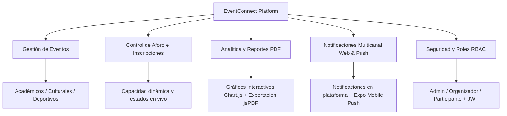
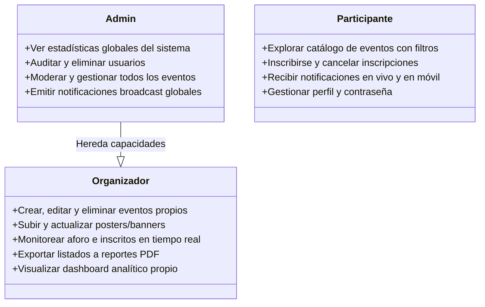
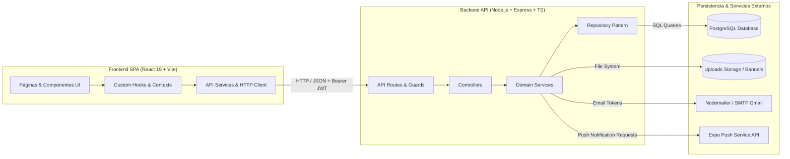
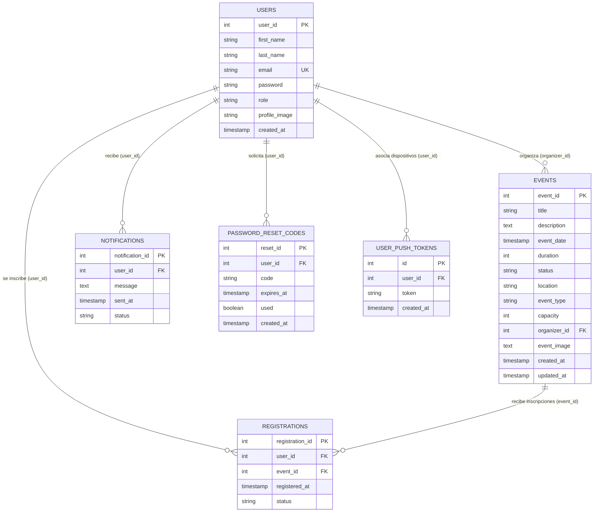
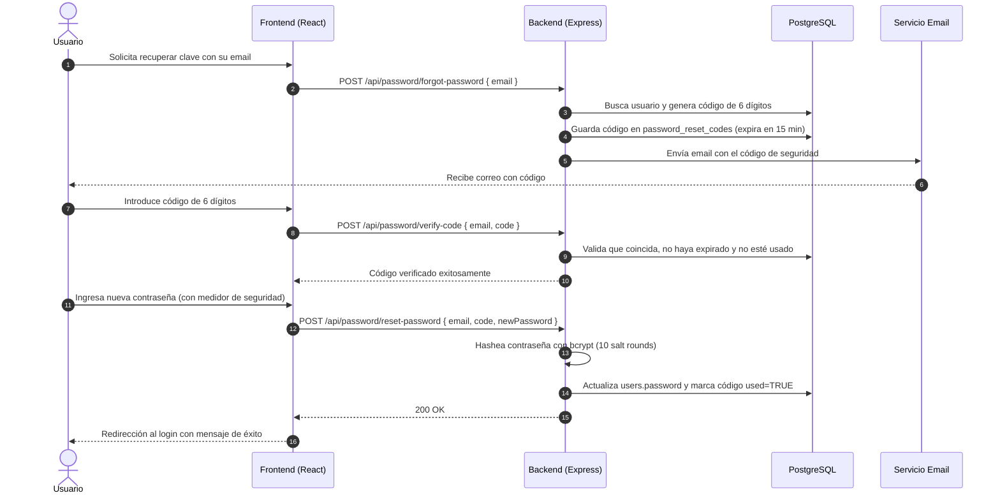
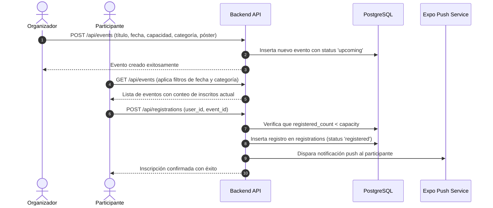

# 📖 EventConnect - Especificación y Visión del Proyecto

> Documento técnico y funcional que describe la naturaleza, arquitectura, casos de uso y valor del sistema **EventConnect**.

---

## 1. 🎯 ¿Qué es EventConnect?

**EventConnect** es una plataforma web integral diseñada para la **gestión, publicación, control de asistencia y análisis de eventos** en entornos institucionales, académicos, culturales y deportivos.

El sistema resuelve la necesidad de coordinar eventos de forma centralizada, ofreciendo a organizadores y administradores herramientas avanzadas de control de cupos, reportes analíticos y comunicación multicanal, al tiempo que brinda a los participantes una experiencia moderna, fluida y transparente para descubrir eventos e inscribirse en ellos.

---

## 2. 💡 Problemas del Mundo Real que Resuelve

1. **Descentralización y desorden en la convocatoria**: En muchas organizaciones, los eventos se anuncian a través de canales dispersos (redes sociales, correos manuales, carteleras), dificultando la visibilidad unificada y el control formal de quién asiste.
2. **Sobre-cupo y falta de control de capacidad**: Sin un sistema transaccional con validación de concurrencia, los eventos se saturan o se desperdician plazas si alguien cancela su asistencia sin aviso.
3. **Carencia de métricas accionables**: Los organizadores no disponen de estadísticas para evaluar qué temáticas convocan más público, la estacionalidad de las inscripciones o la tasa de cancelación.
4. **Inseguridad y gestión precaria de accesos**: Proteger los datos personales de asistentes y contar con autenticación moderna (JWT, hashing bcrypt, recuperación de clave con código temporal) es indispensable para cumplir estándares de privacidad.
5. **Generación manual y tardía de reportes**: La recopilación manual de listados de asistencia para fines acreditativos o logísticos genera retrasos y errores humanos; EventConnect lo automatiza mediante exportación directa a PDF.

---

## 3. 👥 Roles del Sistema y Modelo de Permisos (RBAC)

EventConnect opera con un esquema estricto de **Control de Acceso Basado en Roles**:

### Matriz Detallada de Permisos

| Módulo / Acción | Administrador | Organizador | Participante |
| :--- | :---: | :---: | :---: |
| Explorar catálogo de eventos | ✅ | ✅ | ✅ |
| Inscribirse / Cancelar inscripción | ✅ | ✅ | ✅ |
| Crear y editar eventos con banner | ✅ | ✅ (propios) | ❌ |
| Eliminar eventos | ✅ (cualquiera) | ✅ (propios) | ❌ |
| Descargar reportes PDF de inscritos | ✅ | ✅ (sus eventos) | ❌ |
| Acceso al Dashboard de métricas | ✅ | ✅ | ❌ |
| Gestión global de usuarios y roles | ✅ | ❌ | ❌ |
| Difusión de notificaciones masivas | ✅ | ❌ | ❌ |
| Actualización de perfil y avatar | ✅ | ✅ | ✅ |

---

## 4. 🏗️ Arquitectura de Software y Patrones de Diseño

El sistema está construido siguiendo los principios de **separación de responsabilidades**, **modularidad por capas** y **comunicación desacoplada**:

### 1. Patrón Repository en Backend
En lugar de mezclar consultas SQL en los controladores, cada módulo (`authentication`, `events`, `notifications`, `tokens`) divide sus funciones en:
- **Routes**: Exposición y enlace con middlewares de autenticación (`authMiddleware`, `adminMiddleware`).
- **Controllers**: Recepción de peticiones HTTP, validación inicial de parámetros y armado de respuestas estandarizadas.
- **Services**: Lógica de negocio (cálculo de aforo, control de estados, llamadas a correo/push).
- **Repositories**: Capa de acceso a datos directa a PostgreSQL mediante transacciones y consultas parametrizadas.

### 2. Frontend React con Arquitectura Component-Driven
- **Hooks desacoplados**: `useAuth`, `useDashboard`, `useEvents`, `useNotifications`, `useSessionExpired` encapsulan el ciclo de vida y la sincronización con la API.
- **Detección reactiva de caducidad de sesión**: Interceptor global en `api.ts` que captura códigos 401 o payloads con expiración de JWT para activar el modal de alerta y redirigir sin pérdida abrupta de contexto.
- **Generación de documentos client-side**: Uso de `jspdf` y `jspdf-autotable` para componer reportes en PDF sin sobrecargar el servidor backend.

---

## 5. 🗄️ Modelo de Datos (Diagrama Entidad-Relación)

La base de datos relacional PostgreSQL garantiza consistencia estricta, integridad referencial y alto rendimiento:

### Reglas de Integridad Destacadas:
- **`events.event_type`**: Restricción `CHECK (event_type IN ('academico', 'cultural', 'deportivo'))`.
- **`events.status`**: Estados controlados: `'upcoming'` (próximo), `'in_progress'` (en curso), `'completed'` (finalizado).
- **`registrations`**: Restricción `UNIQUE(user_id, event_id)` que impide que un participante se registre duplicado en el mismo evento.
- **`ON DELETE CASCADE`**: Al eliminar un evento o usuario, sus inscripciones y notificaciones asociadas se limpian automáticamente para evitar registros huérfanos.

---

## 6. 🔄 Flujos Operativos y Casos de Uso Clave

### Flujo 1: Autenticación y Recuperación Segura de Contraseña

---

### Flujo 2: Ciclo de Vida de un Evento y Control de Aforo

---

### Flujo 3: Exportación de Reportes PDF

1. El organizador o administrador accede a la sección de **Gestión de Inscripciones**.
2. Aplica filtros según el evento deseado, estado de los inscritos o búsqueda por nombre/correo.
3. Al hacer clic en **Exportar Reporte**, se abre el modal de opciones (formato de columnas, ordenación).
4. El generador [pdfGenerator.ts](file:///c:/Proyectos-HojaDeVida/eventconnect/frontend/src/utils/pdfGenerator.ts) instancia un documento `jsPDF`, renderiza el membrete oficial de EventConnect, añade la tabla estilizada con `jspdf-autotable` y activa la descarga automática sin latencia de red.

---

## 7. 🌟 Valor Diferencial para Portafolio

Este proyecto evidencia sólidas competencias en desarrollo de software moderno:

- **Full-Stack End-to-End**: Dominio completo desde el diseño del esquema relacional y endpoints REST tipados en backend, hasta interfaces interactivas y reactivas en frontend.
- **Tipado Estricto de Punta a Punta**: Interfaces compartidas y contratos de tipos en TypeScript para minimizar errores en tiempo de ejecución.
- **Seguridad en la Práctica**: Manejo adecuado de variables de entorno, protección de secretos, prevención de inyecciones SQL con consultas parametrizadas, encriptación bcrypt y roles RBAC.
- **UX/UI Profesional**: Modo oscuro nativo, validación reactiva de formularios, estados de carga y errores manejados con elegancia, además de visualizaciones analíticas con Chart.js.
- **Multiplataforma**: Arquitectura preparada para clientes móviles mediante tokens de Expo Push Notifications.

