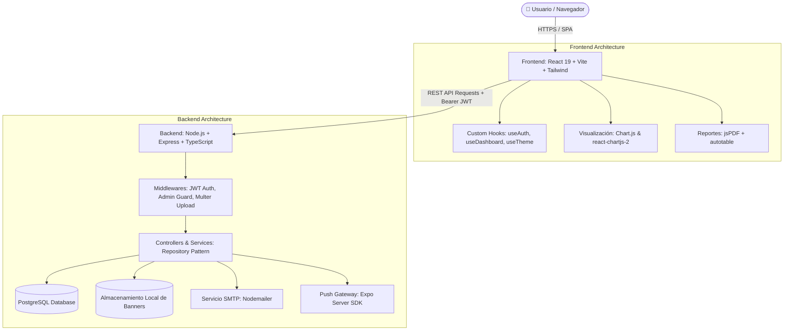

# 🌐 EventConnect

<div align="center">


**Plataforma Integral de Gestión de Eventos, Control de Asistencia y Analítica Multicanal**

[](https://react.dev/)
[](https://www.typescriptlang.org/)
[](https://vitejs.dev/)
[](https://tailwindcss.com/)
[](https://nodejs.org/)
[](https://expressjs.com/)
[](https://www.postgresql.org/)
[](https://opensource.org/licenses/ISC)

[📖 Especificación Completa del Proyecto](PROJECT_OVERVIEW.md) • [📡 Documentación API Backend](backend/API_DOCUMENTATION.md) • [💻 Frontend Docs](frontend/README.md)

</div>

---

## 📌 Descripción General

**EventConnect** es una solución Full-Stack diseñada para centralizar y optimizar el ciclo de vida de eventos académicos, culturales y deportivos. Permite a instituciones, colectivos y organizadores publicar eventos con banners personalizados, regular aforos en tiempo real, auditar inscripciones, generar reportes formales en PDF y notificar a los participantes tanto en la web como en aplicaciones móviles vía notificaciones Push.

> 💡 **Para conocer a fondo el problema de negocio, diagramas de secuencia y justificación técnica, consulta [PROJECT_OVERVIEW.md](PROJECT_OVERVIEW.md).**

---

## 🚀 Funcionalidades Principales

### 🎪 Gestión de Eventos & Aforos
- **Ciclo de vida completo**: Creación, edición, filtrado y eliminación de eventos.
- **Categorización estandarizada**: Eventos clasificados en `académico`, `cultural` y `deportivo`.
- **Control dinámico de capacidad**: Validación en tiempo real del límite de cupos disponibles por evento.
- **Subida de posters/banners**: Carga optimizada de imágenes mediante Multer con previsualización en vivo.
- **Estados automáticos**: Cálculo y visualización de estados (`upcoming`, `in_progress`, `completed`).

### 📊 Dashboard Analítico & Reportes
- **Métricas operativas**: Visualización instantánea de eventos activos, asistentes totales y registros mensuales.
- **Gráficos interactivos**: Integración de Chart.js para análisis de distribución por categorías y series temporales.
- **Exportación a PDF**: Generación en el cliente de reportes profesionales de participantes con membrete y tablas estructuradas (`jsPDF` + `autotable`).

### 🛡️ Panel de Administración (Super Admin)
- **Moderación centralizada**: Control y auditoría de eventos publicados por cualquier organizador.
- **Gestión de usuarios**: Visualización de usuarios, modificación de roles (`participant`, `organizer`, `admin`) y eliminación de cuentas.
- **Mensajería global (Broadcast)**: Envío de anuncios y comunicados del sistema a todos los usuarios.

### 🔔 Notificaciones Multicanal
- **Centro de notificaciones web**: Panel desplegable con contador de no leídas y actualización de estados (`pending`, `sent`, `read`).
- **Soporte Móvil Push (Expo)**: Almacenamiento de tokens push por dispositivo y despacho mediante `expo-server-sdk`.

### 🔐 Seguridad y Autenticación
- **Sesiones con JWT**: Tokens de acceso con verificación de roles mediante middlewares dedicados.
- **Detección de sesión expirada**: Interceptor reactivo que abre un modal de advertencia y redirige al login sin pérdida abrupta de estado.
- **Encriptación unidireccional**: Contraseñas protegidas mediante `bcryptjs` con 10 rondas de salt.
- **Recuperación de contraseña por email**: Flujo de validación con código de seguridad temporal de 6 dígitos enviado por Nodemailer.

### 🎨 Experiencia de Usuario (UI/UX)
- **Tema Claro / Oscuro**: Conmutador fluido con persistencia en `localStorage`.
- **Formularios inteligentes**: Validación reactiva con indicador visual de fortaleza de contraseñas.
- **Diseño responsivo**: Adaptado para resoluciones móviles, tablets y monitores de escritorio.

---

## 🏗️ Arquitectura del Sistema



---

## 🛠️ Tecnologías Empleadas

### Backend
| Tecnología | Versión | Rol en el Proyecto |
| :--- | :---: | :--- |
| **Node.js** | 18+ | Entorno de ejecución en servidor |
| **Express.js** | ^5.1.0 | Framework web REST y enrutamiento |
| **TypeScript** | ^5.9.2 | Tipado estático y robustez del código |
| **PostgreSQL** | 14+ | Base de datos relacional y transaccional |
| **pg (node-postgres)** | ^8.16.3 | Driver cliente para conexión a PostgreSQL |
| **jsonwebtoken** | ^9.0.2 | Generación y validación de tokens de sesión |
| **bcryptjs** | ^3.0.2 | Hashing criptográfico de contraseñas |
| **Multer** | ^2.0.2 | Manejo de subida de archivos multipart |
| **Nodemailer** | ^6.10.1 | Envío de códigos de verificación por SMTP |
| **expo-server-sdk**| ^4.0.0 | Despacho de notificaciones push a clientes Expo |

### Frontend
| Tecnología | Versión | Rol en el Proyecto |
| :--- | :---: | :--- |
| **React** | ^19.1.1 | Biblioteca reactiva para la interfaz de usuario |
| **TypeScript** | ^5.8.3 | Tipado integral de componentes y servicios |
| **Vite** | ^7.1.2 | Bundler y servidor de desarrollo ultrarrápido |
| **Tailwind CSS** | ^4.1.12 | Sistema de estilos utilitarios modernos |
| **React Router** | ^7.8.2 | Enrutador para navegación y protección de rutas |
| **Chart.js** | ^4.5.0 | Motor de renderizado de gráficos estadísticos |
| **jsPDF** | ^3.0.3 | Generación de reportes tabulares en PDF |
| **Lucide React** | ^0.542.0 | Iconografía limpia y accesible |
| **Radix UI** | ^1.2.3 | Primitivas de interfaz sin estilos y accesibles |

---

## 📁 Estructura del Repositorio

```
eventconnect/
├── backend/                             # Servidor API REST (Express + TypeScript)
│   ├── authentication/                  # Módulo de Auth (login, registro, perfiles, passwords)
│   │   ├── controllers/
│   │   ├── middlewares/
│   │   ├── models/
│   │   ├── repositories/
│   │   ├── routes/
│   │   └── services/
│   ├── config/                          # Conexión DB, variables de entorno y JWT
│   ├── events/                          # Módulo de gestión y filtros de eventos
│   ├── notifications/                   # Módulo de notificaciones web y push
│   ├── tokens/                          # Módulo de almacenamiento de tokens push Expo
│   ├── middleware/                      # Subida de imágenes con Multer
│   ├── migrations/                      # Scripts SQL de migraciones controladas
│   ├── tests/                           # Pruebas de conectividad y servicios
│   ├── uploads/                         # Directorio de banners y avatares
│   ├── database.sql                     # Script DDL/DML completo de PostgreSQL
│   ├── .env.example                     # Plantilla de variables de entorno (segura)
│   └── package.json
│
├── frontend/                            # Aplicación Cliente (React 19 + Vite + Tailwind)
│   ├── public/                          # Recursos estáticos servidos directamente
│   ├── src/
│   │   ├── components/                  # Componentes reutilizables (forms, charts, modals, ui)
│   │   ├── config/                      # Configuración de Axios/Fetch y API URL
│   │   ├── contexts/                    # Contextos globales de React (Dashboard, etc.)
│   │   ├── hooks/                       # Hooks personalizados (useAuth, useTheme, etc.)
│   │   ├── pages/                       # Vistas (Dashboard, Events, Admin, Registrations...)
│   │   ├── services/                    # Clientes de consumo HTTP hacia la API
│   │   ├── types/                       # Interfaces y contratos de datos TypeScript
│   │   └── utils/                       # Generador de PDF, dateUtils y validaciones
│   ├── .env.example                     # Plantilla de variables del frontend
│   └── package.json
│
├── .gitignore                           # Exclusión de secrets, zips, logs y temporales
├── PROJECT_OVERVIEW.md                  # Especificación profunda, arquitectura y diagramas
└── README.md                            # Documentación principal del proyecto
```

---

## ⚙️ Guía de Instalación y Puesta en Marcha

### Prerrequisitos
- **Node.js** (v18.0 o superior)
- **PostgreSQL** (v14.0 o superior)
- **npm** o gestor de paquetes equivalente

---

### 1. Clonar el Repositorio
```bash
git clone https://github.com/<tu-usuario>/eventconnect.git
cd eventconnect
```

---

### 2. Configurar la Base de Datos PostgreSQL
1. Abre tu cliente de PostgreSQL (pgAdmin, DBeaver o `psql`).
2. Ejecuta el archivo de inicialización [database.sql](file:///c:/Proyectos-HojaDeVida/eventconnect/backend/database.sql):
```bash
psql -U postgres -f backend/database.sql
```
> Esto creará la base de datos `eventconnect`, las tablas, índices, restricciones y usuarios iniciales de prueba.

---

### 3. Configurar el Backend
```bash
cd backend
npm install
```

Copia la plantilla de variables de entorno y ajusta tus credenciales locales:
```bash
cp .env.example .env
```

Edita `.env` con tus credenciales:
```env
PORT=3001
DB_HOST=localhost
DB_PORT=5432
DB_USER=postgres
DB_PASSWORD=tu_password
DB_NAME=eventconnect
JWT_SECRET=tu_clave_secreta_jwt_muy_segura
JWT_EXPIRES_IN=24h
EMAIL_USER=tu_correo@gmail.com
EMAIL_PASS=tu_app_password_de_gmail
```

Inicia el servidor backend:
```bash
npm start
```
El servidor arrancará en `http://localhost:3001`.

---

### 4. Configurar el Frontend
En una nueva terminal:
```bash
cd frontend
npm install
```

Copia la plantilla de variables de entorno:
```bash
cp .env.example .env
```

Contenido de `.env`:
```env
VITE_API_URL=http://localhost:3001/api
```

Inicia el servidor de desarrollo:
```bash
npm run dev
```
La aplicación web estará disponible en `http://localhost:5173`.

---

## 🔑 Credenciales de Demostración

Para probar inmediatamente todos los roles en la plataforma sin necesidad de registrar nuevos datos, puedes utilizar las cuentas sembradas en `database.sql`:

| Rol | Correo Electrónico | Contraseña | Capacidades |
| :--- | :--- | :--- | :--- |
| **Administrador** | `admin@eventconnect.com` | `Admin123` | Control total, usuarios, moderación global y métricas del sistema |
| **Organizador** | `organizer@eventconnect.com` | `organizer123` | Creación/edición de eventos, control de asistentes y exportación PDF |

---

## 📡 Resumen de Endpoints de la API

| Módulo | Método | Endpoint | Acceso | Descripción |
| :--- | :---: | :--- | :---: | :--- |
| **Auth** | `POST` | `/api/auth/register` | Público | Registro de usuarios |
| **Auth** | `POST` | `/api/auth/login` | Público | Autenticación y expedición de JWT |
| **Password** | `POST` | `/api/password/forgot-password` | Público | Envío de código de recuperación al email |
| **Password** | `POST` | `/api/password/verify-code` | Público | Validación del código de 6 dígitos |
| **Password** | `POST` | `/api/password/reset-password` | Público | Establecimiento de nueva contraseña |
| **Events** | `GET` | `/api/events` | Público | Listar eventos con filtros (categoría, fecha) |
| **Events** | `POST` | `/api/events` | `organizer`, `admin` | Crear evento con póster (Multipart) |
| **Events** | `PUT` | `/api/events/:id` | `organizer`, `admin` | Actualizar evento existente |
| **Events** | `DELETE` | `/api/events/:id` | `organizer`, `admin` | Eliminar evento |
| **Registrations** | `POST` | `/api/registrations` | Autenticado | Inscribirse a un evento (con control de aforo) |
| **Registrations** | `GET` | `/api/registrations/event/:id` | `organizer`, `admin` | Obtener participantes inscritos |
| **Dashboard** | `GET` | `/api/dashboard/stats` | `organizer`, `admin` | Obtener estadísticas resumidas |
| **Dashboard** | `GET` | `/api/dashboard/events/upcoming` | `organizer`, `admin` | Eventos más próximos |
| **Admin** | `GET` | `/api/admin/users` | `admin` | Listado maestro de usuarios |
| **Admin** | `PATCH` | `/api/admin/users/:id/role` | `admin` | Cambiar rol a un usuario |
| **Admin** | `POST` | `/api/admin/notifications/broadcast` | `admin` | Difusión global de notificaciones |

> Para especificaciones detalladas de payloads y respuestas JSON, consulta:
> - [API General](backend/API_DOCUMENTATION.md)
> - [API de Administración](backend/ADMIN_API_DOCUMENTATION.md)
> - [API de Inscripciones](backend/REGISTRATIONS_API_DOCUMENTATION.md)

---

## 🔒 Seguridad y Buenas Prácticas

- **Exclusión de Secretos**: Los archivos `.env` reales, contraseñas de aplicación y credenciales de base de datos están estrictamente excluidos de Git mediante `.gitignore`.
- **Plantillas Seguras**: Se proporcionan `.env.example` tanto para el backend como para el frontend con valores ficticios e instrucciones claras.
- **Prevención de Inyecciones SQL**: Todas las consultas a PostgreSQL utilizan sentencias parametrizadas (`$1, $2, ...`) a través de la librería `pg`.
- **Validación de Archivos**: La subida de imágenes verifica tipos MIME permitidos y restringe el tamaño a un máximo de 5 MB.
- **Limpieza de Artefactos**: Repositorio optimizado, libre de archivos `.zip`, volcados de depuración o logs innecesarios.

---

## 📄 Licencia

Este proyecto está distribuido bajo la licencia **ISC**. Consulta los archivos de paquete para más detalles.
